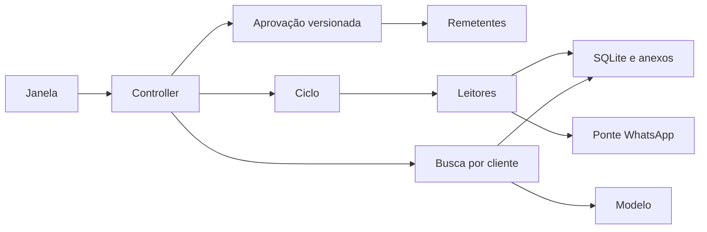

# Requisitos

### Objetivo
Corrigir os problemas ainda apontados na última revalidação, sem remover a aprovação humana nem reenviar automaticamente uma entrega incerta.

### Resultado esperado
- Aprovação vinculada exatamente ao texto, destinatário, canal e clientes apresentados; clientes divergentes impedem a aprovação e aprovados legados voltam para revisão.
- Falhas de persistência individuais são informadas e permitem nova tentativa; limpeza de anexos nunca remove documento confirmado nem arquivo que não pertença à tentativa.
- WhatsApp usa leitura com sobreposição e deduplicação por conta, chat e mensagem. Histórico ou mídia indisponível gera aviso, sem manter a vaga aberta; a recuperação não é garantida.
- Busca identifica o cliente apenas antes de `sobre` e exige seleção explícita quando houver múltiplos candidatos.

### Fora do escopo
Extração e indexação automática de documentos, cofre de credenciais, alteração do transporte local em `127.0.0.1`, agendamento com aplicativo fechado e interface de reconciliação de envios incertos. Itens `em curso` continuam bloqueados para reenvio automático.

# Desenho técnico

### Aprovação e envio
Em `src/flow/controller.py`, `src/flow/queue.py` e `src/flow/qml/Main.qml`, apresentar texto, destinatário, canal e ambos os clientes, e passar ao botão uma versão ou impressão digital dos valores exibidos. Comparar e congelar atomicamente; em caso de alteração, recarregar e exigir revisão. Recusar a aprovação se os clientes exibidos divergirem.

Em `src/flow/store.py`, remover o preenchimento histórico em `_freeze_approved` e introduzir migração transacional com marcador persistente: na primeira execução, devolver **todos** os `aprovado` preexistentes a `aguardando`, inclusive os que já receberam cópia fabricada; preservar `em curso` e `enviado`. Gravar o marcador na mesma transação e inicializá-lo também para bancos novos, para não invalidar novas aprovações em aberturas posteriores. Não presumir que uma cópia legada em `em curso` comprove aprovação ou autorize reenvio. Em `src/flow/send.py`, eliminar o fallback para dados vivos e recusar entrega sem cópia completa.

Em `src/flow/send.py` e `src/flow/whatsapp.py`, reservar e ler a mesma versão aprovada atomicamente, validar clientes, canal e um único destinatário compatível antes da entrega. Falhas comprovadamente anteriores à entrega podem liberar a reserva; resultados incertos permanecem `em curso`. Em particular, SMTP deve rejeitar canal diferente de `email`.

### Coleta e anexos
Em `src/flow/incoming.py`, retornar resultado estruturado com mensagens salvas, duplicadas e falhas de persistência, sem interromper os demais itens. Adaptar `src/flow/mail.py`, `src/flow/whatsapp.py`, `src/flow/controller.py` e `src/flow/cycle.py`: preservar sucessos, informar falhas por canal e manter a vaga aberta quando um item não puder ser gravado; manter a política existente para falhas gerais de coleta. A repetição deve deduplicar sucessos já persistidos.

Em `src/flow/paths.py` e `src/flow/incoming.py`, coordenar anexos e transação externa por staging e registro recuperável de caminhos pertencentes à tentativa, inclusive escritas parciais. Após rollback ou interrupção, remover exclusivamente caminhos registrados pela própria tentativa que não tenham linha confirmada em `documento`; nunca apagar arquivo referenciado por documento confirmado. Em `src/flow/mail.py`, não tratar contêiner MIME multiparte como anexo nem gravá-lo como arquivo vazio; continuar processando suas partes de conteúdo.

### WhatsApp
Em `src/flow/whatsapp.py`, fornecer à ponte a janela de sobreposição, padrão de sete dias e ajustável nos testes. Em `src/flow/baileys/bridge.mjs`, deduplicar por chat e ID e ajustar `applyCursor` e `askGap` para solicitar e aceitar histórico dentro dessa janela, com paginação quando suportada. Avançar o cursor por chat apenas após commit e sem regredir, parando diante de falha de gravação; uma mídia indisponível não deve, por si só, bloqueá-lo. Sinalizar falhas de histórico e mídia, inclusive limite de tamanho, sem classificá-las como falha de persistência nem manter a vaga aberta por essa incompletude. Não prometer histórico que a ponte ou o serviço não entreguem.

### Busca
Em `src/flow/harness.py`, localizar candidatos somente no trecho anterior ao mesmo separador `sobre` usado para extrair o tema, sem escolher o mais longo quando houver múltiplos candidatos. Sem ID selecionado e com mais de um candidato, retornar a lista para seleção, sem chamar o modelo nem criar rascunho. Adaptar `src/flow/controller.py` e `src/flow/qml/Main.qml` para apresentar candidatos e devolver o ID escolhido ao harness; validar o ID antes da busca. Preservar `search_trechos_do_cliente` em `src/flow/store.py` e verificar que `src/flow/llm.py` envia ao modelo somente trechos desse cliente.

### Fluxo

### Limites
Uma janela de sete dias não recupera mensagens mais antigas, ausentes do histórico ou não entregues pela integração. A aprovação humana continua necessária e nenhuma estratégia local garante entrega externa exatamente uma vez.

# Testes

### Validação
Atualizar testes existentes em `tests/test_stage*.py` conforme os componentes afetados e executar a suíte completa.

- Alterar texto, destino, canal ou cliente depois da exibição; verificar rejeição, clientes divergentes e nova revisão. Atualizar `test_old_approved_row_receives_a_copy`: cobrir cópias fabricadas já presentes, migração única, reabertura após nova aprovação, preservação de `em curso` e `enviado`, falta de cópia, concorrência e canal incorreto.
- Simular falha no meio de lote, rollback externo, escrita parcial e interrupção; confirmar retentativa sem duplicatas e limpeza apenas dos caminhos registrados, preservando documentos confirmados. Cobrir contêiner MIME multiparte com nome e suas partes.
- Simular ID igual em chats diferentes, mensagem tardia em janela encurtada, cursor sem regressão e commit com falha. Histórico ou mídia indisponível deve gerar aviso sem prender vaga ou cursor; falha de gravação deve manter a vaga aberta.
- Buscar `Quando falei com Bruno sobre Ana Lima`, múltiplos candidatos antes de `sobre` e homônimos; verificar ausência de chamada e rascunho antes da escolha, ID selecionado e isolamento do payload do modelo.

# Delivery Steps

### ✓ Step 1: Vincular aprovação à versão exibida
A aprovação passa a corresponder exatamente aos dados revisados pelo usuário.

- Atualizar `controller.py`, `queue.py` e `qml/Main.qml` para exibir clientes e rejeitar divergência ou alteração dos dados apresentados.
- Migrar uma única vez todos os aprovados antigos em `store.py`, inclusive cópias fabricadas, preservando `em curso` e `enviado`.
- Atualizar `send.py` e `whatsapp.py` para reservar atomicamente a cópia completa e validar canal e destinatário, sem fallback nem reenvio incerto.
- Atualizar o teste legado de cópia e cobrir marcador, reabertura, divergência, concorrência e canal.

### ✓ Step 2: Tornar coleta e anexos recuperáveis
Falhas individuais ficam visíveis e não deixam anexos inconsistentes.

- Propagar falhas de persistência por item em `incoming.py`, `mail.py`, `whatsapp.py`, `controller.py` e `cycle.py`, preservando sucessos e mantendo a vaga aberta.
- Coordenar staging e recuperação em `paths.py` e `incoming.py`, removendo apenas caminhos registrados pela tentativa sem documento confirmado.
- Impedir que contêineres MIME multipartes virem anexos vazios em `mail.py`.
- Testar rollback, interrupção, preservação de documentos confirmados, repetição segura e manutenção da vaga.

### ✓ Step 3: Recuperar mensagens atrasadas do WhatsApp
A coleta do WhatsApp relê uma janela de histórico e deduplica por conversa.

- Passar de `whatsapp.py` à `baileys/bridge.mjs` a janela configurável, padrão de sete dias, e implementar chave composta e leitura com sobreposição.
- Garantir avanço monotônico e pós-commit do cursor, bloqueando-o por falha de gravação, não por mídia indisponível.
- Sinalizar histórico e mídia indisponíveis sem manter a vaga aberta por essa razão; paginar quando possível.
- Testar mensagens tardias, IDs repetidos em chats, aviso sem bloqueio, falha de gravação e cursor.

### ✓ Step 4: Exigir identificação inequívoca na busca
A busca usa um cliente confirmado e não confunde o assunto com o destinatário.

- Identificar candidatos antes de `sobre` em `harness.py` e aceitar o ID selecionado explicitamente.
- Adaptar `controller.py` e `qml/Main.qml` para apresentar candidatos sem chamar o modelo ou criar rascunho antes da escolha.
- Verificar o filtro por cliente e os trechos efetivamente entregues ao modelo em `store.py` e `llm.py`.
- Cobrir múltiplos candidatos, homônimos e nomes no tema e executar a suíte completa.